# uView Flutter 组件库使用说明

> 本文档由示例应用自动截图生成，截图来自 Android 模拟器（API 36）。
> 每个组件包含**效果截图**与**用法示例**；带“交互效果”的组件需点击后才会出现对应界面。

## 快速开始

在应用顶层用 `UView` 注入主题后即可使用全部组件：

```dart
import 'package:flutter/material.dart';
import 'package:uview_flutter/uview_flutter.dart';

void main() => runApp(const MyApp());

class MyApp extends StatelessWidget {
  const MyApp({Key? key}) : super(key: key);

  @override
  Widget build(BuildContext context) {
    return UView(
      theme: const UViewThemeData(),
      child: MaterialApp(home: const HomePage()),
    );
  }
}
```

运行时可通过 `UView.update(context, ...)` 切换主题。

## 组件总览

**基础组件**

- [Button 按钮](#button-按钮) — type / plain / round / loading / block / icon
- [Text 文本](#text-文本) — type 取主题色、bold、lines 截断
- [Tag 标签](#tag-标签) — type / plain / round / closable / 自定义色
- [Badge 徽标数](#badge-徽标数) — 数字 / 圆点 / 溢出 / 角标包裹
- [Cell 单元格](#cell-单元格) — title / value / label / isLink / required
- [Icon 图标](#icon-图标) — 按名称取图标，统一主题色
- [Image 图片](#image-图片) — circle / radius / 加载与失败占位
- [Loading 加载](#loading-加载) — 圆环 spinner，可换色换尺寸
- [Gap 间隔](#gap-间隔) — 布局中等距间隔
- [Layout 布局](#layout-布局) — URow / UCol，支持 gap
- [Divider 分割线](#divider-分割线) — 中间文字 / 虚线 / 对齐

**表单组件**

- [Form 表单](#form-表单) — UFormItem + 校验
- [Input 输入框](#input-输入框) — clearable / password / 前后缀
- [Textarea 文本域](#textarea-文本域) — 计数 / 多行
- [Search 搜索](#search-搜索) — 搜索图标 + 清空
- [VerificationCode 验证码](#verificationcode-验证码) — 输入框 + 倒计时
- [Checkbox 复选框](#checkbox-复选框) — 多选组
- [Radio 单选框](#radio-单选框) — 单选组
- [Switch 开关](#switch-开关) — 开关选择器
- [Select 选择器](#select-选择器) — 底部弹窗列表
- [NumberBox 步进器](#numberbox-步进器) — min/max/step
- [Slider 滑动](#slider-滑动) — 滑动选择器
- [Rate 评分](#rate-评分) — 星级评分
- [Picker 滚轮选择器](#picker-滚轮选择器) — 多列滚轮 / 字段触发
- [Calendar 日历](#calendar-日历) — 月历单日选择
- [Upload 上传](#upload-上传) — 上传格子（接 onAdd）
- [Keyboard 键盘](#keyboard-键盘) — 自定义数字键盘

**反馈组件**

- [Toast 轻提示](#toast-轻提示) — 全局 Overlay / loading
- [AlertTips 警告](#alerttips-警告) — 内嵌提示条
- [Modal 模态框](#modal-模态框) — 确认/取消对话框
- [Popup 弹出层](#popup-弹出层) — 多方向弹出
- [ActionSheet 操作菜单](#actionsheet-操作菜单) — 底部操作菜单
- [NoticeBar 通知](#noticebar-通知) — 滚动通知条
- [Collapse 折叠面板](#collapse-折叠面板) — 手风琴/多开
- [SwipeAction 滑动](#swipeaction-滑动) — 左滑操作按钮

**导航组件**

- [Navbar 导航栏](#navbar-导航栏) — 顶部标题/返回/操作
- [Tabbar 标签栏](#tabbar-标签栏) — 底部切换
- [Tabs 标签页](#tabs-标签页) — 顶部标签页
- [Steps 步骤条](#steps-步骤条) — 横向步骤
- [Dropdown 下拉菜单](#dropdown-下拉菜单) — 浮层选项
- [BackTop 返回顶部](#backtop-返回顶部) — 滚动吸顶按钮

**布局组件**

- [Grid 宫格](#grid-宫格) — 多列图标网格
- [Swiper 轮播](#swiper-轮播) — 自动轮播 + 指示点
- [Avatar 头像](#avatar-头像) — 圆形/方形
- [Empty 空状态](#empty-空状态) — 空数据占位
- [Skeleton 骨架屏](#skeleton-骨架屏) — 加载占位动画
- [Sticky 吸顶](#sticky-吸顶) — 滚动吸顶
- [Waterfall 瀑布流](#waterfall-瀑布流) — 多列不等高

**数据/其他**

- [Progress 进度条](#progress-进度条) — 百分比/主题色
- [CountDown 倒计时](#countdown-倒计时) — 天时分秒
- [CountTo 数字滚动](#countto-数字滚动) — 动画计数
- [Card 卡片](#card-卡片) — 标题/内容容器
- [LoadMore 加载更多](#loadmore-加载更多) — 加载状态

**其他组件**

- [FloatingBall 悬浮球](#floatingball-悬浮球) — 可拖拽 / 展开菜单

## 基础组件

### Button 按钮

**说明**：type / plain / round / loading / block / icon

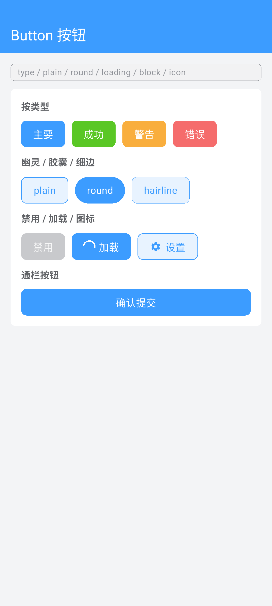

<details>
<summary>用法示例（点击展开）</summary>

```dart
class ButtonDemo extends StatelessWidget {
  const ButtonDemo({Key? key}) : super(key: key);
  @override
  Widget build(BuildContext context) {
    return UCol(
      crossAxisAlignment: CrossAxisAlignment.start,
      gap: 12,
      children: [
        const UText('按类型', bold: true),
        URow(
          gap: 10,
          children: const [
            UButton(text: '主要', type: UViewType.primary),
            UButton(text: '成功', type: UViewType.success),
            UButton(text: '警告', type: UViewType.warning),
            UButton(text: '错误', type: UViewType.error),
          ],
        ),
        const UText('幽灵 / 胶囊 / 细边', bold: true),
        URow(
          gap: 10,
          children: const [
            UButton(text: 'plain', plain: true),
            UButton(text: 'round', round: true),
            UButton(text: 'hairline', plain: true, hairline: true),
          ],
        ),
        const UText('禁用 / 加载 / 图标', bold: true),
        URow(
          gap: 10,
          children: const [
            UButton(text: '禁用', disabled: true),
            UButton(text: '加载', loading: true),
            UButton(text: '设置', icon: Icons.settings, plain: true),
          ],
        ),
        const UText('通栏按钮', bold: true),
        const UButton(text: '确认提交', block: true, onPressed: null),
      ],
    );
  }
}
```

</details>

### Text 文本

**说明**：type 取主题色、bold、lines 截断

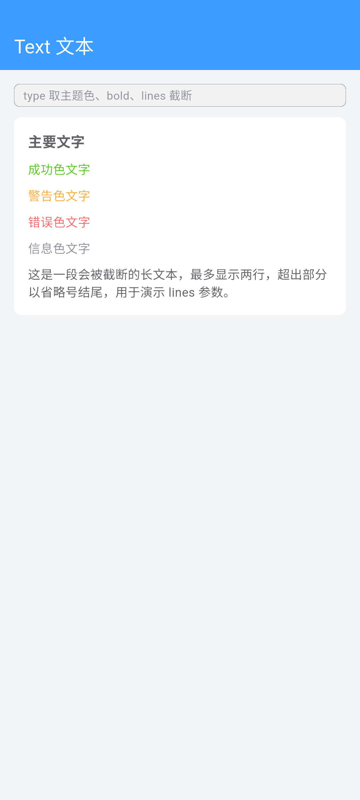

<details>
<summary>用法示例（点击展开）</summary>

```dart
class TextDemo extends StatelessWidget {
  const TextDemo({Key? key}) : super(key: key);
  @override
  Widget build(BuildContext context) {
    return UCol(
      crossAxisAlignment: CrossAxisAlignment.start,
      gap: 10,
      children: const [
        UText('主要文字', type: UViewType.def, bold: true, size: 16),
        UText('成功色文字', type: UViewType.success),
        UText('警告色文字', type: UViewType.warning),
        UText('错误色文字', type: UViewType.error),
        UText('信息色文字', type: UViewType.info),
        UText(
          '这是一段会被截断的长文本，最多显示两行，超出部分以省略号结尾，用于演示 lines 参数。',
          lines: 2,
        ),
      ],
    );
  }
}
```

</details>

### Tag 标签

**说明**：type / plain / round / closable / 自定义色

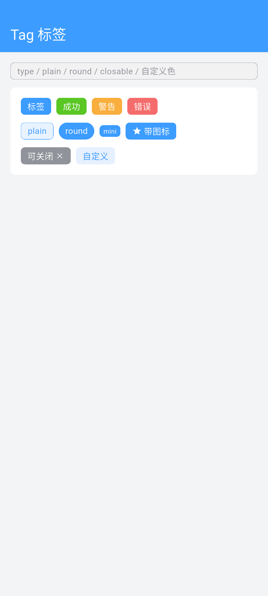

<details>
<summary>用法示例（点击展开）</summary>

```dart
class TagDemo extends StatelessWidget {
  const TagDemo({Key? key}) : super(key: key);
  @override
  Widget build(BuildContext context) {
    return UCol(
      crossAxisAlignment: CrossAxisAlignment.start,
      gap: 12,
      children: [
        URow(
          gap: 8,
          children: const [
            UTag(text: '标签', type: UViewType.primary),
            UTag(text: '成功', type: UViewType.success),
            UTag(text: '警告', type: UViewType.warning),
            UTag(text: '错误', type: UViewType.error),
          ],
        ),
        URow(
          gap: 8,
          children: const [
            UTag(text: 'plain', plain: true),
            UTag(text: 'round', round: true),
            UTag(text: 'mini', size: UViewSize.mini),
            UTag(text: '带图标', icon: Icons.star, type: UViewType.primary),
          ],
        ),
        URow(
          gap: 8,
          children: const [
            UTag(text: '可关闭', closable: true, type: UViewType.info),
            UTag(text: '自定义', bgColor: Color(0xFFE6F0FF), textColor: Color(0xFF3C9CFF)),
          ],
        ),
      ],
    );
  }
}
```

</details>

### Badge 徽标数

**说明**：数字 / 圆点 / 溢出 / 角标包裹

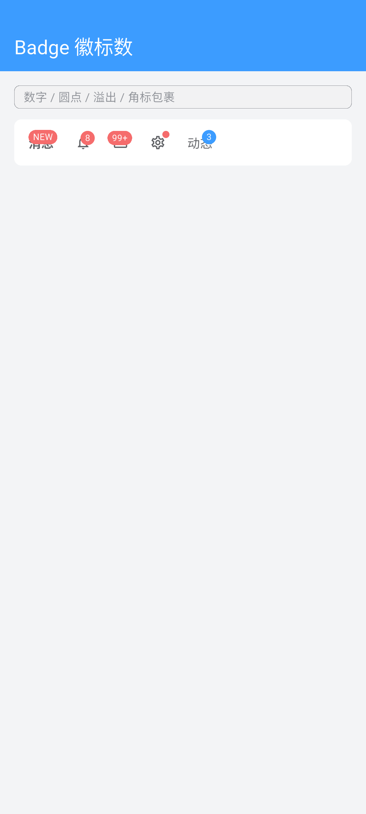

<details>
<summary>用法示例（点击展开）</summary>

```dart
class BadgeDemo extends StatelessWidget {
  const BadgeDemo({Key? key}) : super(key: key);
  @override
  Widget build(BuildContext context) {
    return URow(
      gap: 24,
      children: [
        const UBadge(text: 'NEW', child: UText('消息', bold: true)),
        const UBadge(count: 8, child: UIcon(name: 'bell')),
        const UBadge(count: 199, child: UIcon(name: 'email')),
        const UBadge(isDot: true, child: UIcon(name: 'setting')),
        const UBadge(count: 3, type: UViewType.primary, child: UText('动态')),
      ],
    );
  }
}
```

</details>

### Cell 单元格

**说明**：title / value / label / isLink / required

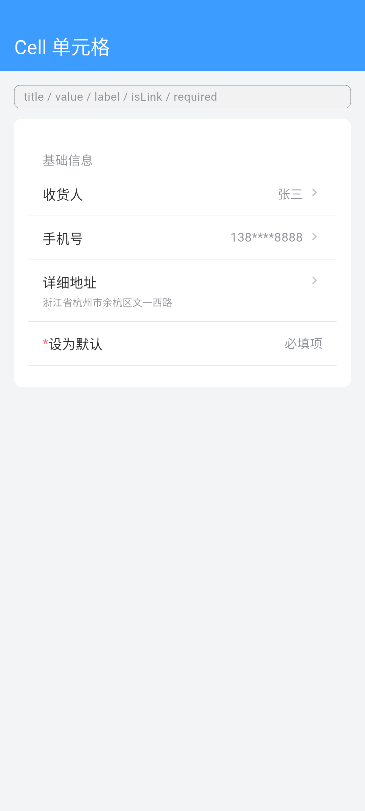

<details>
<summary>用法示例（点击展开）</summary>

```dart
class CellDemo extends StatelessWidget {
  const CellDemo({Key? key}) : super(key: key);
  @override
  Widget build(BuildContext context) {
    return UCellGroup(
      title: '基础信息',
      children: [
        const UCell(title: '收货人', value: '张三', isLink: true),
        const UCell(title: '手机号', value: '138****8888', isLink: true),
        const UCell(title: '详细地址', label: '浙江省杭州市余杭区文一西路', isLink: true),
        const UCell(title: '设为默认', required: true, value: '必填项'),
      ],
    );
  }
}
```

</details>

### Icon 图标

**说明**：按名称取图标，统一主题色

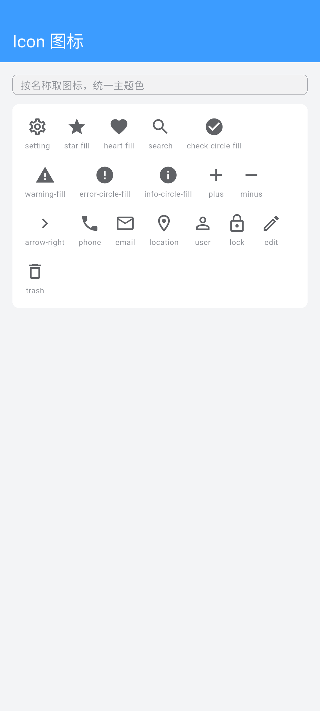

<details>
<summary>用法示例（点击展开）</summary>

```dart
class IconDemo extends StatelessWidget {
  const IconDemo({Key? key}) : super(key: key);
  static const names = [
    'setting', 'star-fill', 'heart-fill', 'search', 'check-circle-fill',
    'warning-fill', 'error-circle-fill', 'info-circle-fill', 'plus', 'minus',
    'arrow-right', 'phone', 'email', 'location', 'user', 'lock', 'edit', 'trash',
  ];
  @override
  Widget build(BuildContext context) {
    return Wrap(
      spacing: 18,
      runSpacing: 18,
      children: names
          .map((n) => Column(
                mainAxisSize: MainAxisSize.min,
                children: [
                  UIcon(name: n, size: 26),
                  const SizedBox(height: 4),
                  UText(n, size: 10, type: UViewType.info),
                ],
              ))
          .toList(),
    );
  }
}
```

</details>

### Image 图片

**说明**：circle / radius / 加载与失败占位

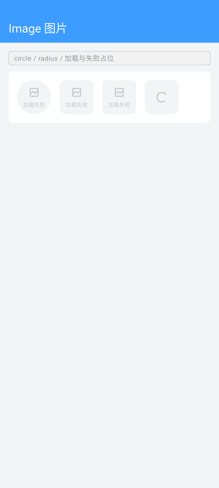

<details>
<summary>用法示例（点击展开）</summary>

```dart
class ImageDemo extends StatelessWidget {
  const ImageDemo({Key? key}) : super(key: key);
  @override
  Widget build(BuildContext context) {
    const url = 'https://uviewpro.cn/logo.png';
    return URow(
      gap: 16,
      children: [
        const UImage(src: url, width: 64, height: 64, shape: UViewShape.circle),
        const UImage(src: url, width: 64, height: 64, radius: 12),
        const UImage(src: url, width: 64, height: 64),
        const UImage(src: null, width: 64, height: 64, radius: 12),
      ],
    );
  }
}
```

</details>

### Loading 加载

**说明**：圆环 spinner，可换色换尺寸

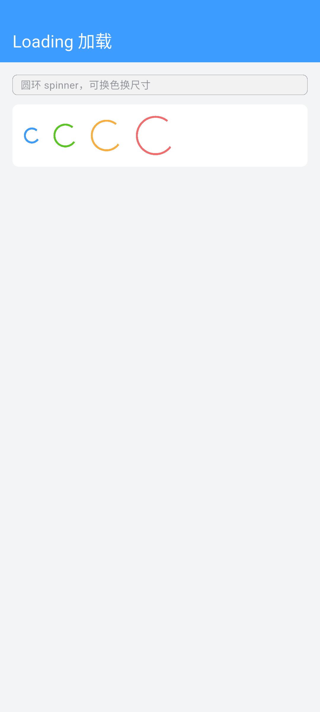

<details>
<summary>用法示例（点击展开）</summary>

```dart
class LoadingDemo extends StatelessWidget {
  const LoadingDemo({Key? key}) : super(key: key);
  @override
  Widget build(BuildContext context) {
    return URow(
      gap: 20,
      children: const [
        ULoading(size: 18),
        ULoading(size: 28, type: UViewType.success),
        ULoading(size: 38, type: UViewType.warning),
        ULoading(size: 48, type: UViewType.error),
        ULoading(show: false),
      ],
    );
  }
}
```

</details>

### Gap 间隔

**说明**：布局中等距间隔

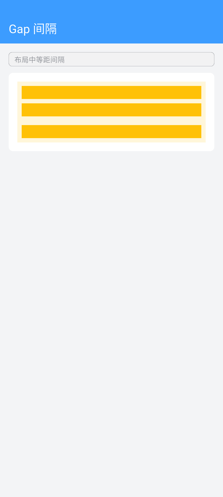

<details>
<summary>用法示例（点击展开）</summary>

```dart
class GapDemo extends StatelessWidget {
  const GapDemo({Key? key}) : super(key: key);
  @override
  Widget build(BuildContext context) {
    return Container(
      color: Colors.amber.withOpacity(0.15),
      padding: const EdgeInsets.all(8),
      child: UCol(
        gap: 0,
        children: [
          Container(height: 24, color: Colors.amber),
          const UGap(height: 8),
          Container(height: 24, color: Colors.amber),
          const UGap(height: 16),
          Container(height: 24, color: Colors.amber),
        ],
      ),
    );
  }
}
```

</details>

### Layout 布局

**说明**：URow / UCol，支持 gap

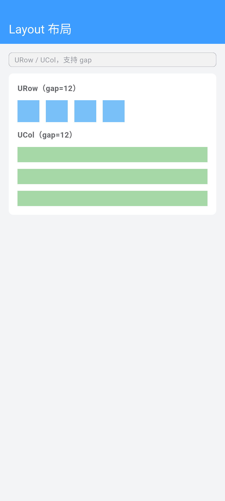

<details>
<summary>用法示例（点击展开）</summary>

```dart
class LayoutDemo extends StatelessWidget {
  const LayoutDemo({Key? key}) : super(key: key);
  @override
  Widget build(BuildContext context) {
    return UCol(
      crossAxisAlignment: CrossAxisAlignment.start,
      gap: 12,
      children: [
        const UText('URow（gap=12）', bold: true),
        URow(
          gap: 12,
          children: List.generate(
              4, (i) => Container(width: 40, height: 40, color: Colors.blue.withOpacity(0.6))),
        ),
        const UText('UCol（gap=12）', bold: true),
        UCol(
          gap: 12,
          children: List.generate(
              3, (i) => Container(height: 28, color: Colors.green.withOpacity(0.5))),
        ),
      ],
    );
  }
}
```

</details>

### Divider 分割线

**说明**：中间文字 / 虚线 / 对齐

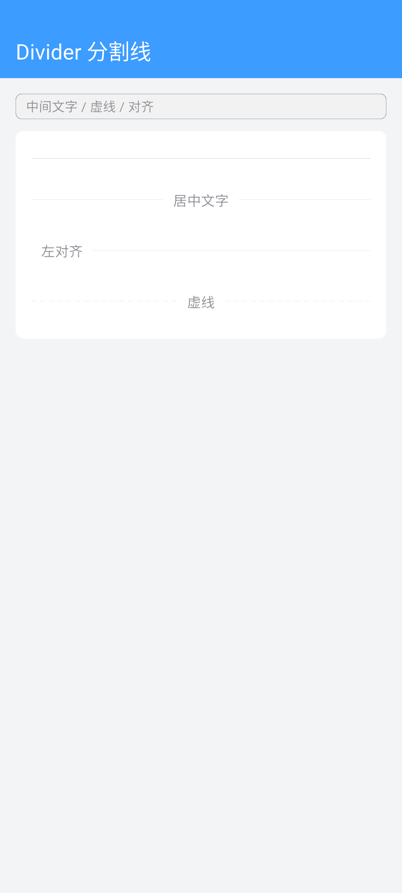

<details>
<summary>用法示例（点击展开）</summary>

```dart
class DividerDemo extends StatelessWidget {
  const DividerDemo({Key? key}) : super(key: key);
  @override
  Widget build(BuildContext context) {
    return const UCol(
      crossAxisAlignment: CrossAxisAlignment.start,
      gap: 8,
      children: [
        UDivider(),
        UDivider(text: '居中文字'),
        UDivider(text: '左对齐', textAlign: MainAxisAlignment.start),
        UDivider(text: '虚线', dashed: true),
      ],
    );
  }
}
```

</details>

## 表单组件

### Form 表单

**说明**：UFormItem + 校验

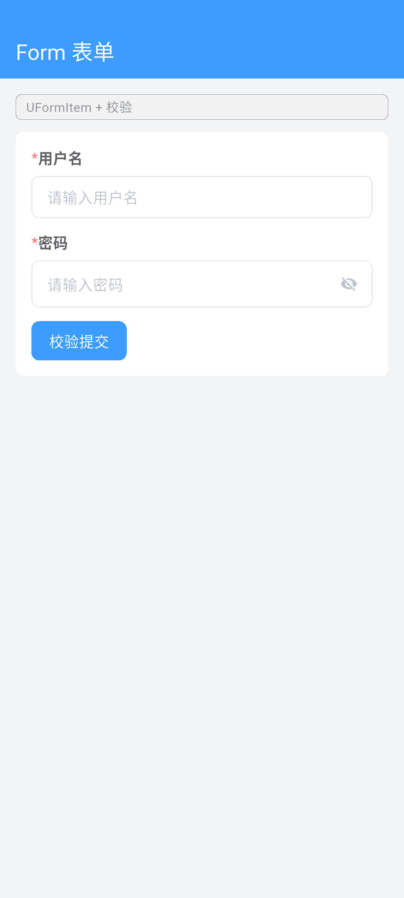

交互效果：

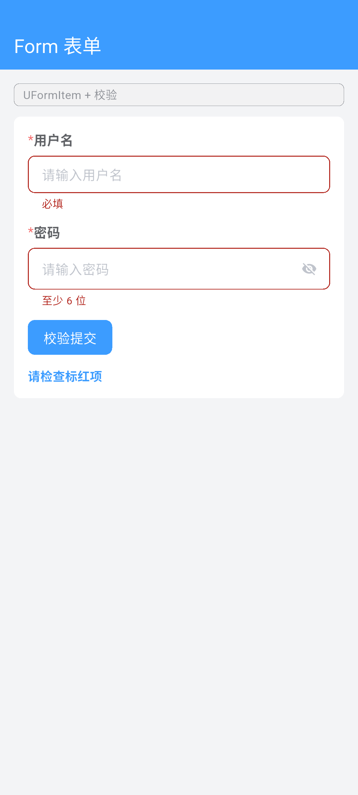

<details>
<summary>用法示例（点击展开）</summary>

```dart
class FormDemo extends StatefulWidget {
  const FormDemo({Key? key}) : super(key: key);
  @override
  _FormDemoState createState() => _FormDemoState();
}

class _FormDemoState extends State<FormDemo> {
  final UFormController _ctrl = UFormController();
  String? _msg;
  @override
  Widget build(BuildContext context) {
    return UCol(
      gap: 14,
      crossAxisAlignment: CrossAxisAlignment.start,
      children: [
        UForm(
          controller: _ctrl,
          child: UCol(
            gap: 14,
            crossAxisAlignment: CrossAxisAlignment.start,
            children: [
              UFormItem(
                label: '用户名',
                required: true,
                child: UInput(
                  placeholder: '请输入用户名',
                  validator: (v) => (v == null || v.isEmpty) ? '必填' : null,
                ),
              ),
              UFormItem(
                label: '密码',
                required: true,
                child: UInput(
                  password: true,
                  clearable: true,
                  placeholder: '请输入密码',
                  validator: (v) => (v != null && v.length < 6) ? '至少 6 位' : null,
                ),
              ),
            ],
          ),
        ),
        UButton(
          text: '校验提交',
          onPressed: () {
            final ok = _ctrl.validate();
            setState(() => _msg = ok ? '校验通过' : '请检查标红项');
          },
        ),
        if (_msg != null) UText(_msg!, type: UViewType.primary, bold: true),
      ],
    );
  }
}
```

</details>

### Input 输入框

**说明**：clearable / password / 前后缀

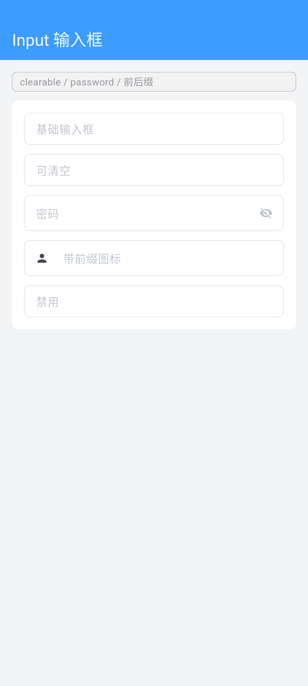

<details>
<summary>用法示例（点击展开）</summary>

```dart
class InputDemo extends StatelessWidget {
  const InputDemo({Key? key}) : super(key: key);
  @override
  Widget build(BuildContext context) {
    return const UCol(
      gap: 12,
      crossAxisAlignment: CrossAxisAlignment.start,
      children: [
        UInput(placeholder: '基础输入框'),
        UInput(placeholder: '可清空', clearable: true),
        UInput(placeholder: '密码', password: true, clearable: true),
        UInput(placeholder: '带前缀图标', prefixIcon: Icon(Icons.person, size: 18)),
        UInput(placeholder: '禁用', enabled: false),
      ],
    );
  }
}
```

</details>

### Textarea 文本域

**说明**：计数 / 多行

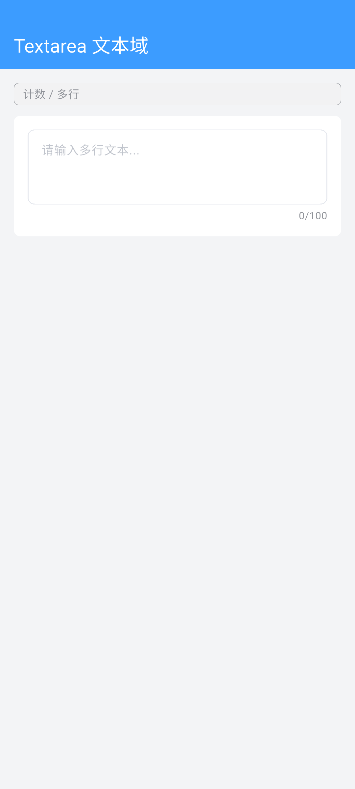

<details>
<summary>用法示例（点击展开）</summary>

```dart
class TextareaDemo extends StatelessWidget {
  const TextareaDemo({Key? key}) : super(key: key);
  @override
  Widget build(BuildContext context) =>
      const UTextarea(placeholder: '请输入多行文本...', maxLength: 100, showCounter: true, maxLines: 3);
}
```

</details>

### Search 搜索

**说明**：搜索图标 + 清空

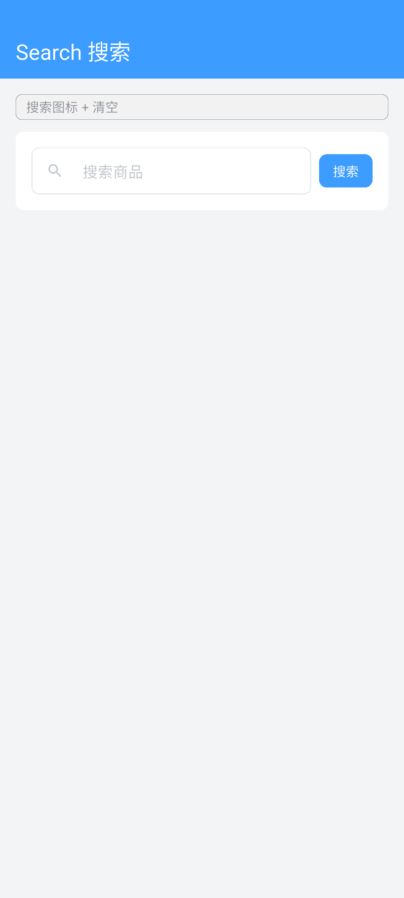

<details>
<summary>用法示例（点击展开）</summary>

```dart
class SearchDemo extends StatelessWidget {
  const SearchDemo({Key? key}) : super(key: key);
  @override
  Widget build(BuildContext context) => const USearch(placeholder: '搜索商品');
}
```

</details>

### VerificationCode 验证码

**说明**：输入框 + 倒计时

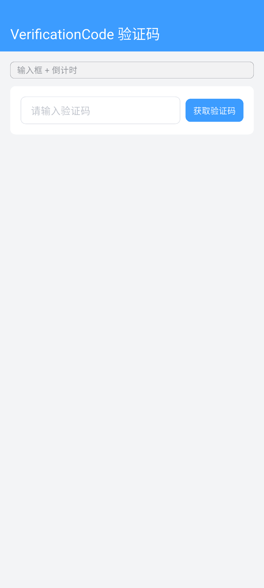

<details>
<summary>用法示例（点击展开）</summary>

```dart
class VerificationCodeDemo extends StatelessWidget {
  const VerificationCodeDemo({Key? key}) : super(key: key);
  @override
  Widget build(BuildContext context) => const UVerificationCode();
}
```

</details>

### Checkbox 复选框

**说明**：多选组

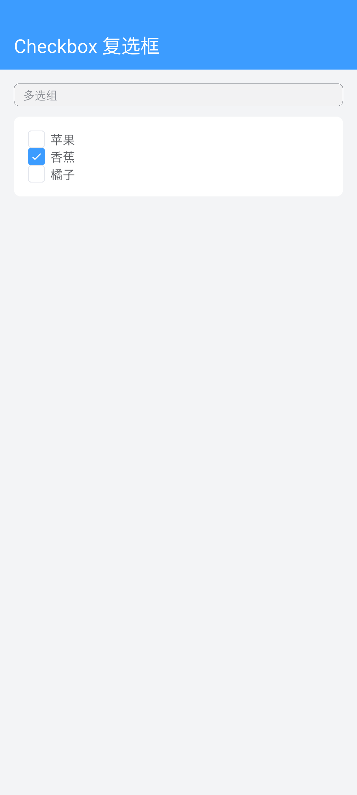

<details>
<summary>用法示例（点击展开）</summary>

```dart
class CheckboxDemo extends StatefulWidget {
  const CheckboxDemo({Key? key}) : super(key: key);
  @override
  _CheckboxDemoState createState() => _CheckboxDemoState();
}

class _CheckboxDemoState extends State<CheckboxDemo> {
  List<String> _v = ['b'];
  @override
  Widget build(BuildContext context) => UCheckboxGroup<String>(
        value: _v,
        onChanged: (v) => setState(() => _v = v),
        options: const [
          UCheckboxOption('苹果', 'a'),
          UCheckboxOption('香蕉', 'b'),
          UCheckboxOption('橘子', 'c'),
        ],
      );
}
```

</details>

### Radio 单选框

**说明**：单选组

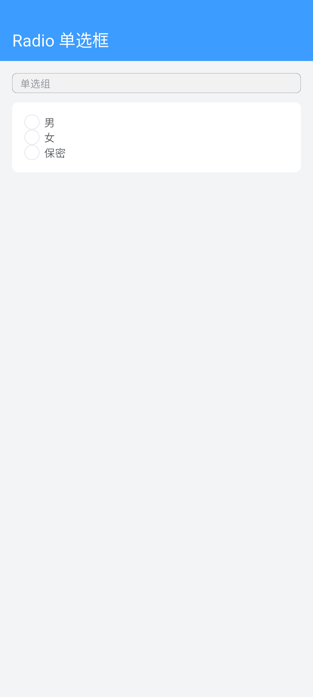

<details>
<summary>用法示例（点击展开）</summary>

```dart
class RadioDemo extends StatefulWidget {
  const RadioDemo({Key? key}) : super(key: key);
  @override
  _RadioDemoState createState() => _RadioDemoState();
}

class _RadioDemoState extends State<RadioDemo> {
  String? _v = 'b';
  @override
  Widget build(BuildContext context) => URadioGroup<String>(
        value: _v,
        onChanged: (v) => setState(() => _v = v),
        options: const [
          URadioOption('男', 'male'),
          URadioOption('女', 'female'),
          URadioOption('保密', 'secret'),
        ],
      );
}
```

</details>

### Switch 开关

**说明**：开关选择器

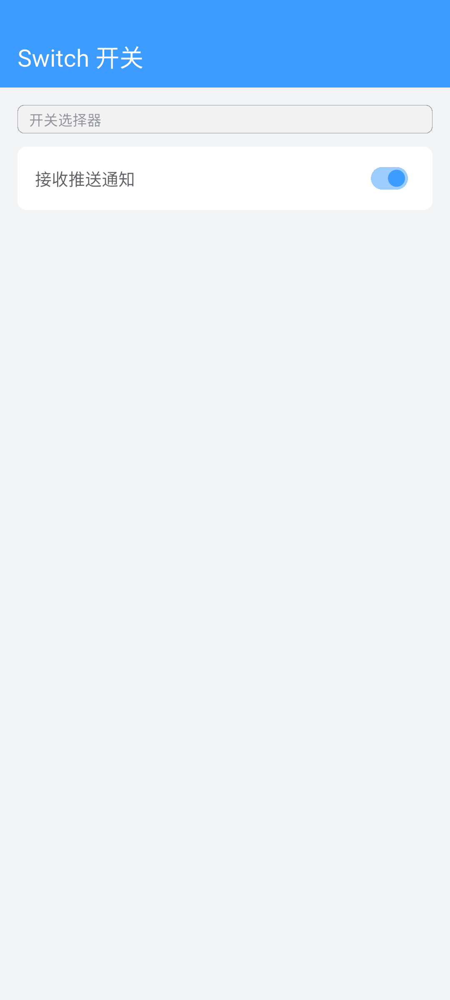

<details>
<summary>用法示例（点击展开）</summary>

```dart
class SwitchDemo extends StatefulWidget {
  const SwitchDemo({Key? key}) : super(key: key);
  @override
  _SwitchDemoState createState() => _SwitchDemoState();
}

class _SwitchDemoState extends State<SwitchDemo> {
  bool _v = true;
  @override
  Widget build(BuildContext context) => URow(
        children: [
          const UText('接收推送通知', size: 15),
          const Spacer(),
          USwitch(value: _v, onChanged: (b) => setState(() => _v = b)),
        ],
      );
}
```

</details>

### Select 选择器

**说明**：底部弹窗列表

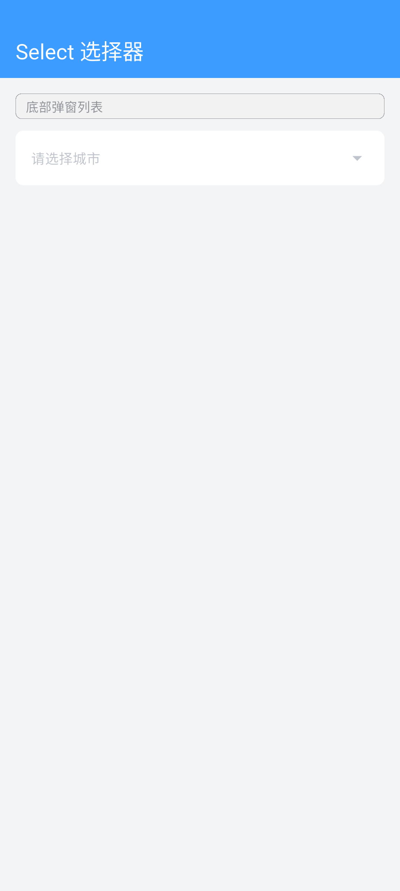

交互效果：

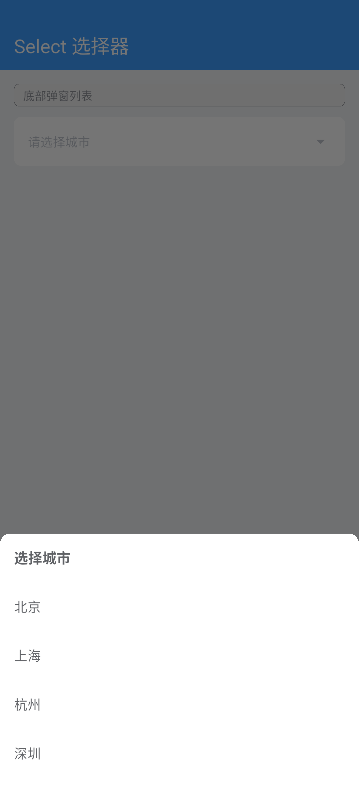

<details>
<summary>用法示例（点击展开）</summary>

```dart
class SelectDemo extends StatefulWidget {
  const SelectDemo({Key? key}) : super(key: key);
  @override
  _SelectDemoState createState() => _SelectDemoState();
}

class _SelectDemoState extends State<SelectDemo> {
  String? _v;
  @override
  Widget build(BuildContext context) => USelect<String>(
        value: _v,
        placeholder: '请选择城市',
        title: '选择城市',
        onChanged: (v) => setState(() => _v = v),
        options: const [
          USelectOption('北京', 'bj'),
          USelectOption('上海', 'sh'),
          USelectOption('杭州', 'hz'),
          USelectOption('深圳', 'sz'),
        ],
      );
}
```

</details>

### NumberBox 步进器

**说明**：min/max/step

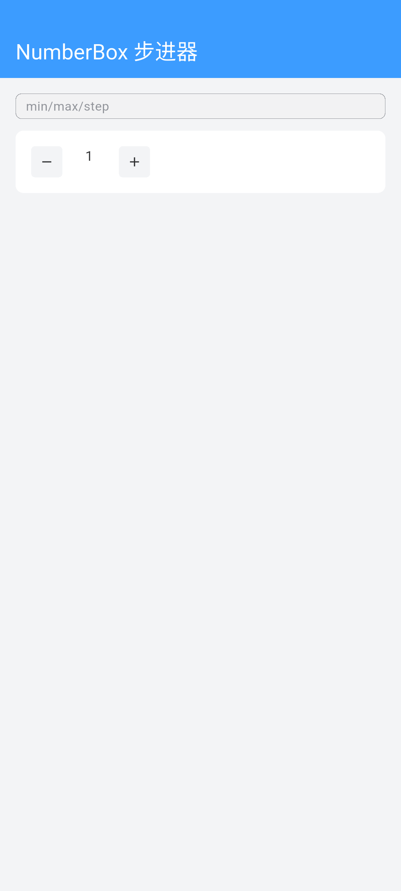

<details>
<summary>用法示例（点击展开）</summary>

```dart
class NumberBoxDemo extends StatefulWidget {
  const NumberBoxDemo({Key? key}) : super(key: key);
  @override
  _NumberBoxDemoState createState() => _NumberBoxDemoState();
}

class _NumberBoxDemoState extends State<NumberBoxDemo> {
  double _v = 1;
  @override
  Widget build(BuildContext context) => UNumberBox(
        value: _v,
        min: 0,
        max: 10,
        onChanged: (v) => setState(() => _v = v),
      );
}
```

</details>

### Slider 滑动

**说明**：滑动选择器

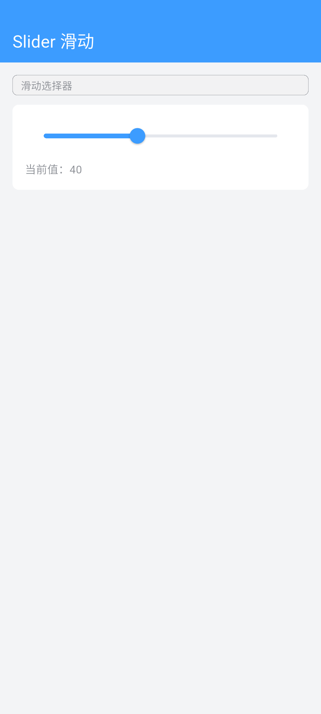

<details>
<summary>用法示例（点击展开）</summary>

```dart
class SliderDemo extends StatefulWidget {
  const SliderDemo({Key? key}) : super(key: key);
  @override
  _SliderDemoState createState() => _SliderDemoState();
}

class _SliderDemoState extends State<SliderDemo> {
  double _v = 40;
  @override
  Widget build(BuildContext context) => UCol(
        gap: 8,
        crossAxisAlignment: CrossAxisAlignment.start,
        children: [
          USlider(value: _v, divisions: 100, label: _v.round().toString(), onChanged: (v) => setState(() => _v = v)),
          UText('当前值：${_v.round()}', type: UViewType.info),
        ],
      );
}
```

</details>

### Rate 评分

**说明**：星级评分

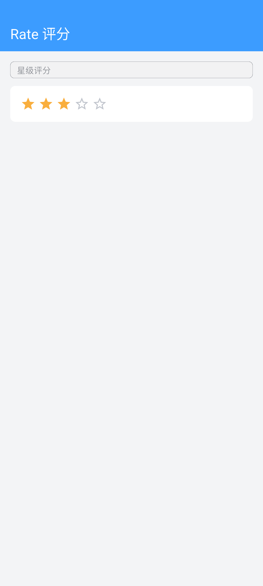

<details>
<summary>用法示例（点击展开）</summary>

```dart
class RateDemo extends StatefulWidget {
  const RateDemo({Key? key}) : super(key: key);
  @override
  _RateDemoState createState() => _RateDemoState();
}

class _RateDemoState extends State<RateDemo> {
  int _v = 3;
  @override
  Widget build(BuildContext context) => URate(value: _v, onChanged: (v) => setState(() => _v = v));
}
```

</details>

### Picker 滚轮选择器

**说明**：多列滚轮 / 字段触发

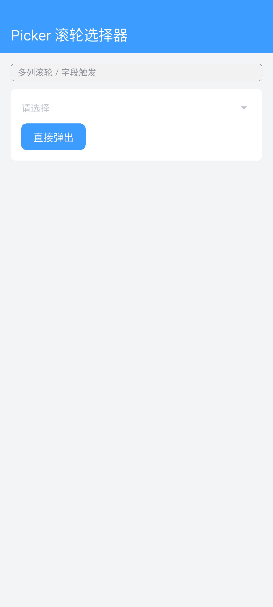

交互效果：

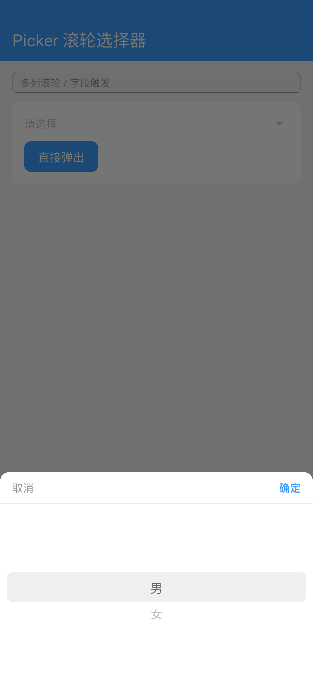

<details>
<summary>用法示例（点击展开）</summary>

```dart
class PickerDemo extends StatefulWidget {
  const PickerDemo({Key? key}) : super(key: key);
  @override
  _PickerDemoState createState() => _PickerDemoState();
}

class _PickerDemoState extends State<PickerDemo> {
  List<int>? _idx;
  void _open() {
    UPicker.show(
      context,
      columns: const [
        ['男', '女'],
      ],
    ).then((r) {
      if (r != null) UToast.show(context, '选择索引: $r');
    });
  }
  @override
  Widget build(BuildContext context) => UCol(
        gap: 12,
        crossAxisAlignment: CrossAxisAlignment.start,
        children: [
          UPickerField(
            columns: const [
              ['周一', '周二', '周三', '周四', '周五', '周六', '周日'],
              ['上午', '下午', '晚上'],
            ],
            valueIndexes: _idx,
            title: '选择时间',
            onChanged: (v) => setState(() => _idx = v),
          ),
          UButton(text: '直接弹出', onPressed: _open),
        ],
      );
}
```

</details>

### Calendar 日历

**说明**：月历单日选择

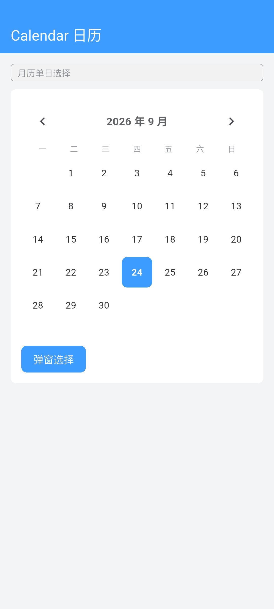

交互效果：

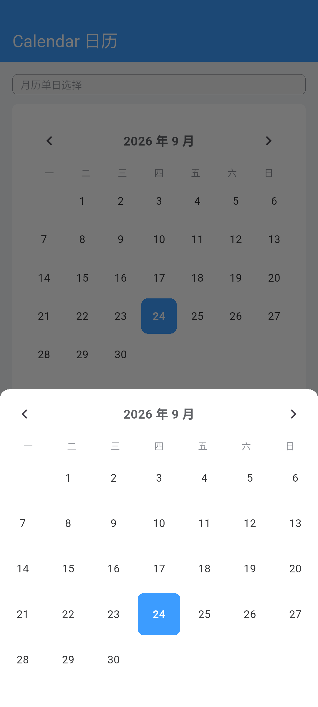

<details>
<summary>用法示例（点击展开）</summary>

```dart
class CalendarDemo extends StatefulWidget {
  const CalendarDemo({Key? key}) : super(key: key);
  @override
  _CalendarDemoState createState() => _CalendarDemoState();
}

class _CalendarDemoState extends State<CalendarDemo> {
  DateTime? _v = DateTime.now();
  void _open() {
    UCalendar.show(context, value: _v).then((r) {
      if (r != null) setState(() => _v = r);
    });
  }
  @override
  Widget build(BuildContext context) => UCol(
        gap: 12,
        crossAxisAlignment: CrossAxisAlignment.start,
        children: [
          UCalendar(value: _v, onChanged: (d) => setState(() => _v = d), type: UViewType.primary),
          UButton(text: '弹窗选择', onPressed: _open),
        ],
      );
}
```

</details>

### Upload 上传

**说明**：上传格子（接 onAdd）

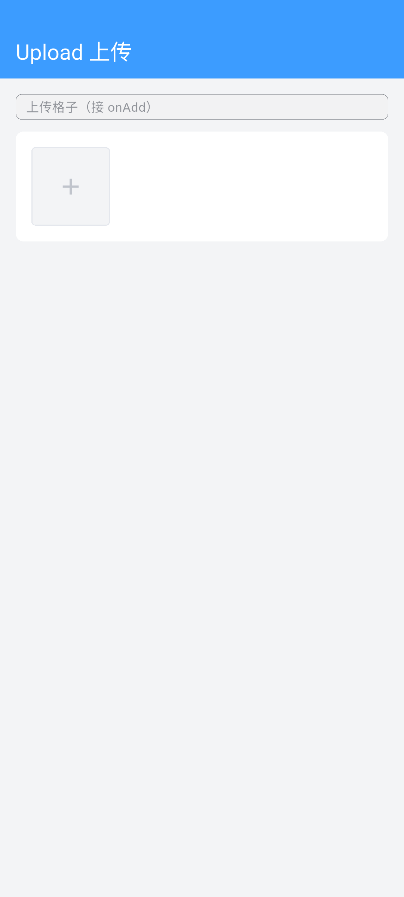

交互效果：

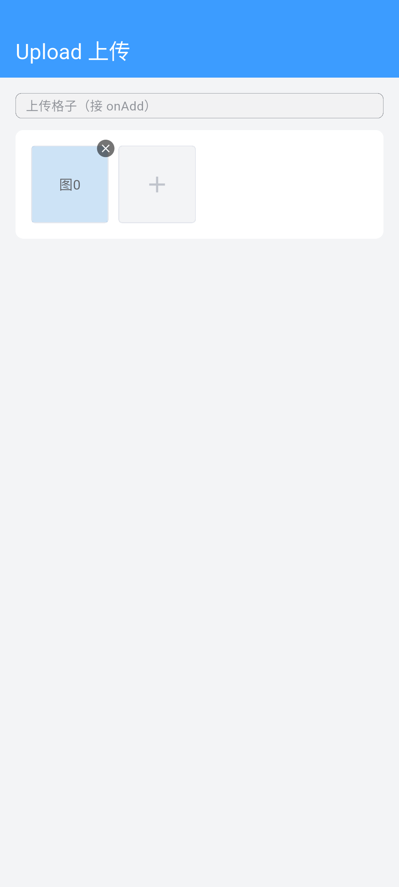

<details>
<summary>用法示例（点击展开）</summary>

```dart
class UploadDemo extends StatefulWidget {
  const UploadDemo({Key? key}) : super(key: key);
  @override
  _UploadDemoState createState() => _UploadDemoState();
}

class _UploadDemoState extends State<UploadDemo> {
  List<UUploadItem> _files = [];
  void _add() {
    final i = _files.length;
    setState(() => _files.add(UUploadItem(
          thumb: Container(
            color: Colors.blue.withOpacity(0.18),
            child: Center(child: UText('图$i')),
          ),
          value: i,
        )));
  }
  void _remove(int i) => setState(() => _files.removeAt(i));
  @override
  Widget build(BuildContext context) =>
      UUpload(files: _files, onAdd: _add, onRemove: _remove, maxCount: 6);
}
```

</details>

### Keyboard 键盘

**说明**：自定义数字键盘

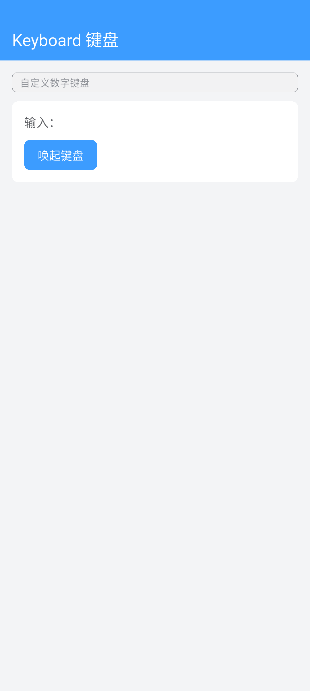

交互效果：

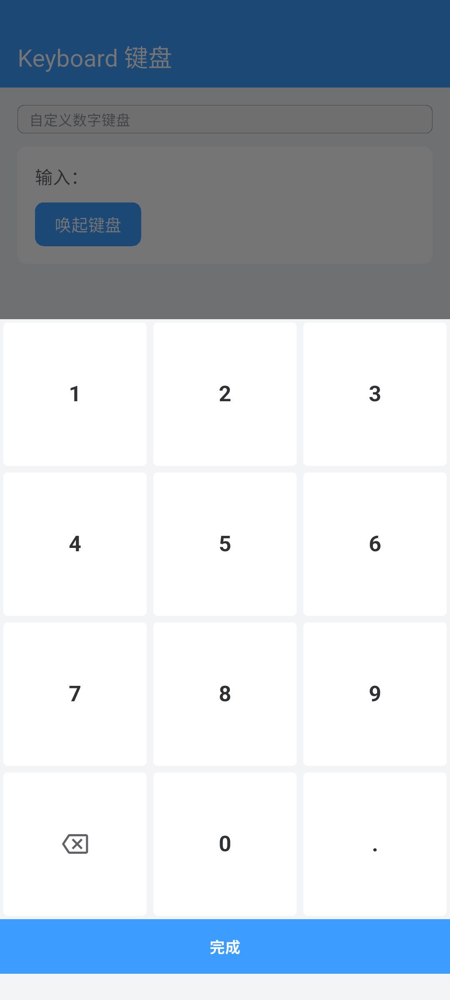

<details>
<summary>用法示例（点击展开）</summary>

```dart
class KeyboardDemo extends StatefulWidget {
  const KeyboardDemo({Key? key}) : super(key: key);
  @override
  _KeyboardDemoState createState() => _KeyboardDemoState();
}

class _KeyboardDemoState extends State<KeyboardDemo> {
  String _text = '';
  void _open() {
    UKeyboard.show(
      context,
      onKey: (k) => setState(() => _text += k),
      onDelete: () => setState(
          () => _text = _text.isNotEmpty ? _text.substring(0, _text.length - 1) : ''),
      onConfirm: () => UToast.show(context, '完成：$_text'),
    );
  }
  @override
  Widget build(BuildContext context) => UCol(
        gap: 12,
        crossAxisAlignment: CrossAxisAlignment.start,
        children: [
          UText('输入：$_text', size: 16),
          UButton(text: '唤起键盘', onPressed: _open),
        ],
      );
}
```

</details>

## 反馈组件

### Toast 轻提示

**说明**：全局 Overlay / loading

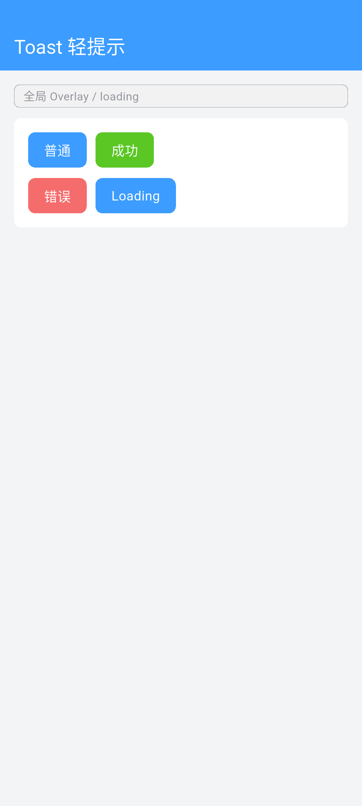

交互效果：

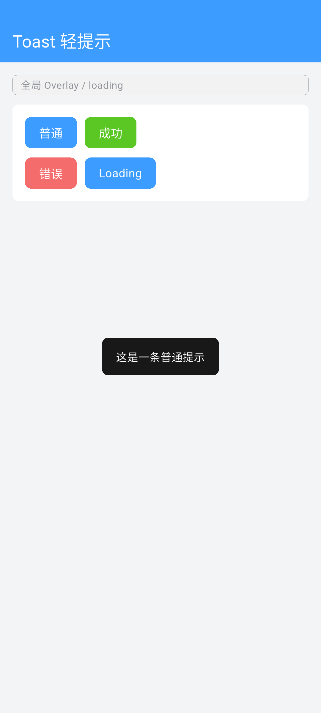

<details>
<summary>用法示例（点击展开）</summary>

```dart
class ToastDemo extends StatelessWidget {
  const ToastDemo({Key? key}) : super(key: key);
  @override
  Widget build(BuildContext context) => UCol(
        gap: 12,
        crossAxisAlignment: CrossAxisAlignment.start,
        children: [
          URow(
            gap: 10,
            children: [
              UButton(text: '普通', onPressed: () => UToast.show(context, '这是一条普通提示')),
              UButton(text: '成功', type: UViewType.success, onPressed: () => UToast.success(context, '操作成功')),
            ],
          ),
          URow(
            gap: 10,
            children: [
              UButton(text: '错误', type: UViewType.error, onPressed: () => UToast.error(context, '操作失败')),
              UButton(text: 'Loading', onPressed: () {
                UToast.loading(context, message: '加载中');
                Future.delayed(const Duration(seconds: 2), () => UToast.hide(context));
              }),
            ],
          ),
        ],
      );
}
```

</details>

### AlertTips 警告

**说明**：内嵌提示条

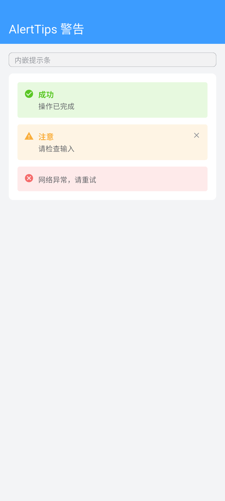

<details>
<summary>用法示例（点击展开）</summary>

```dart
class AlertTipsDemo extends StatelessWidget {
  const AlertTipsDemo({Key? key}) : super(key: key);
  @override
  Widget build(BuildContext context) => UCol(
        gap: 12,
        crossAxisAlignment: CrossAxisAlignment.start,
        children: const [
          UAlertTips(type: UViewType.success, title: '成功', description: '操作已完成'),
          UAlertTips(type: UViewType.warning, title: '注意', description: '请检查输入', showClose: true),
          UAlertTips(type: UViewType.error, description: '网络异常，请重试'),
        ],
      );
}
```

</details>

### Modal 模态框

**说明**：确认/取消对话框

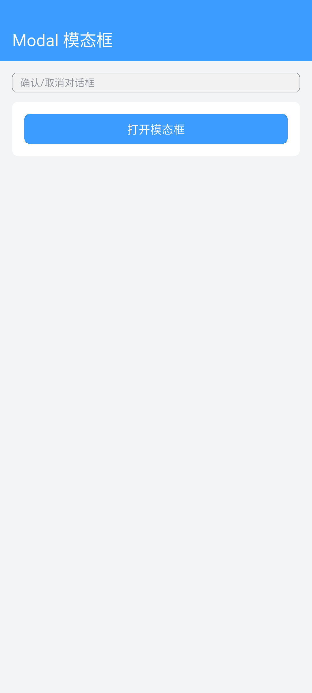

交互效果：

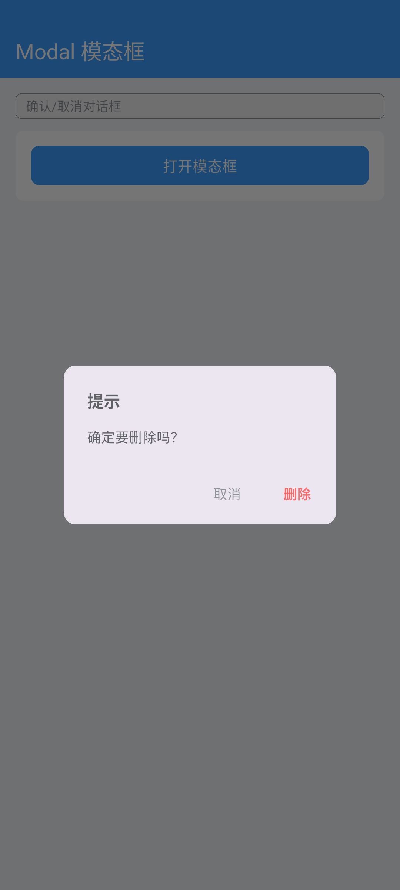

<details>
<summary>用法示例（点击展开）</summary>

```dart
class ModalDemo extends StatelessWidget {
  const ModalDemo({Key? key}) : super(key: key);
  @override
  Widget build(BuildContext context) => UButton(
        text: '打开模态框',
        onPressed: () {
          UModal.show(
            context,
            title: '提示',
            content: '确定要删除吗？',
            confirmText: '删除',
            type: UViewType.error,
          ).then((r) {
            if (r.confirmed) UToast.show(context, '已删除');
          });
        },
      );
}
```

</details>

### Popup 弹出层

**说明**：多方向弹出

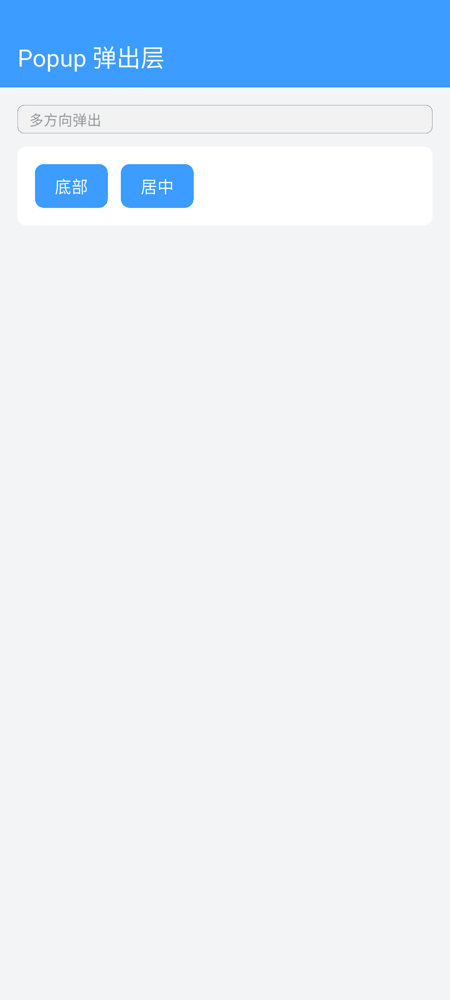

交互效果：

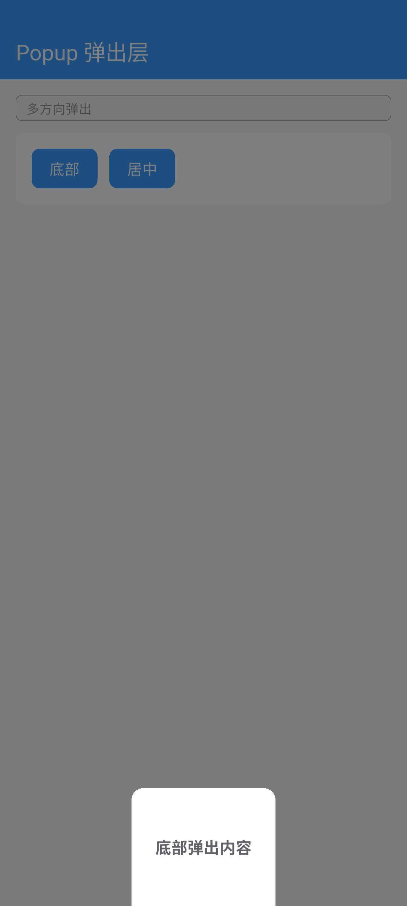

<details>
<summary>用法示例（点击展开）</summary>

```dart
class PopupDemo extends StatelessWidget {
  const PopupDemo({Key? key}) : super(key: key);
  static Widget _panel(String t) =>
      Container(padding: const EdgeInsets.all(24), child: UText(t, bold: true, size: 16));
  @override
  Widget build(BuildContext context) => URow(
        gap: 12,
        children: [
          UButton(text: '底部', onPressed: () => UPopup.show(
                context,
                position: UPopupPosition.bottom,
                child: _panel('底部弹出内容'),
              )),
          UButton(text: '居中', onPressed: () => UPopup.show(
                context,
                position: UPopupPosition.center,
                child: _panel('居中弹出内容'),
              )),
        ],
      );
}
```

</details>

### ActionSheet 操作菜单

**说明**：底部操作菜单

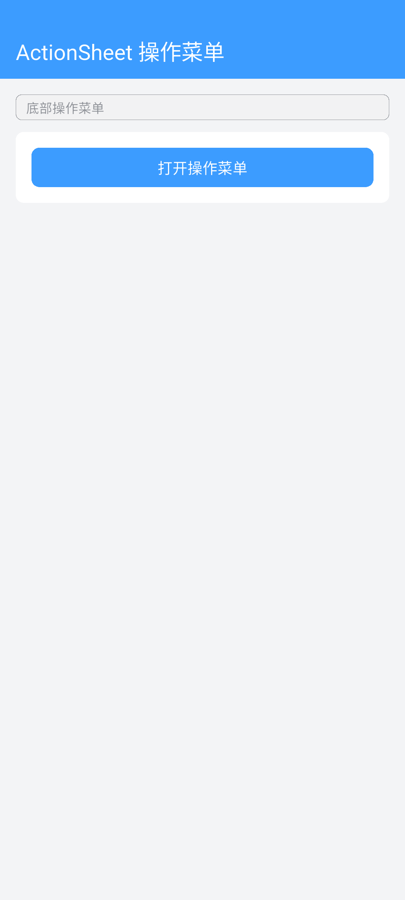

交互效果：

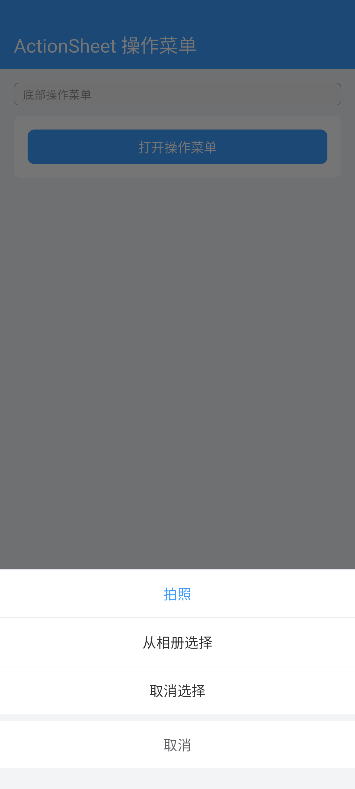

<details>
<summary>用法示例（点击展开）</summary>

```dart
class ActionSheetDemo extends StatelessWidget {
  const ActionSheetDemo({Key? key}) : super(key: key);
  static const _opts = ['拍照', '从相册选择', '取消选择'];
  @override
  Widget build(BuildContext context) => UButton(
        text: '打开操作菜单',
        onPressed: () {
          UActionSheet.show(context, actions: _opts).then((i) {
            if (i != null) UToast.show(context, '选中：${_opts[i]}');
          });
        },
      );
}
```

</details>

### NoticeBar 通知

**说明**：滚动通知条

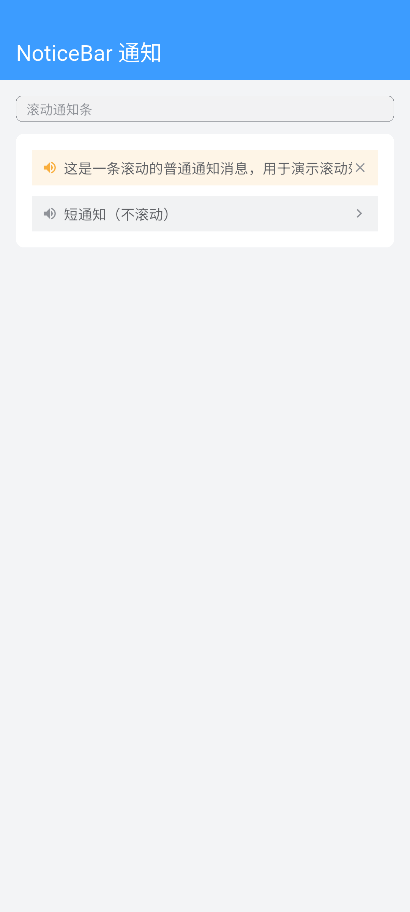

<details>
<summary>用法示例（点击展开）</summary>

```dart
class NoticeBarDemo extends StatelessWidget {
  const NoticeBarDemo({Key? key}) : super(key: key);
  @override
  Widget build(BuildContext context) => UCol(
        gap: 10,
        crossAxisAlignment: CrossAxisAlignment.start,
        children: [
          UNoticeBar(text: '这是一条滚动的普通通知消息，用于演示滚动效果，足够长才会滚动。', mode: UNoticeBarMode.closeable),
          UNoticeBar(text: '短通知（不滚动）', type: UViewType.info, mode: UNoticeBarMode.link, scrollable: false, onTap: () {}),
        ],
      );
}
```

</details>

### Collapse 折叠面板

**说明**：手风琴/多开

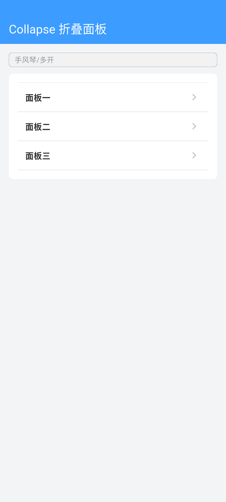

交互效果：

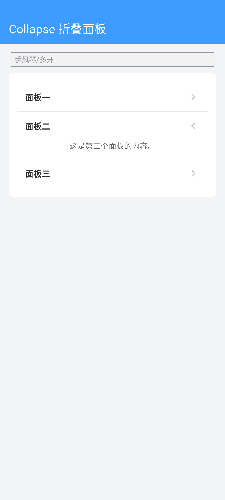

<details>
<summary>用法示例（点击展开）</summary>

```dart
class CollapseDemo extends StatelessWidget {
  const CollapseDemo({Key? key}) : super(key: key);
  @override
  Widget build(BuildContext context) => UCollapse(
        accordion: true,
        children: const [
          UCollapseItem(title: '面板一', content: UText('这是第一个面板的内容。')),
          UCollapseItem(title: '面板二', content: UText('这是第二个面板的内容。')),
          UCollapseItem(title: '面板三', content: UText('这是第三个面板的内容。')),
        ],
      );
}
```

</details>

### SwipeAction 滑动

**说明**：左滑操作按钮


交互效果：

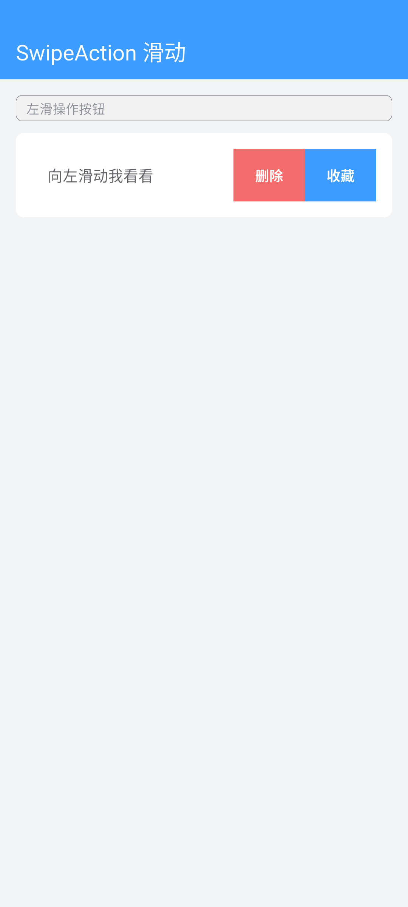

<details>
<summary>用法示例（点击展开）</summary>

```dart
class SwipeActionDemo extends StatelessWidget {
  const SwipeActionDemo({Key? key}) : super(key: key);
  @override
  Widget build(BuildContext context) => USwipeActionCell(
        actions: [
          USwipeAction(text: '删除', type: UViewType.error, onTap: () => UToast.show(context, '删除')),
          USwipeAction(text: '收藏', type: UViewType.primary, onTap: () => UToast.show(context, '收藏')),
        ],
        child: Container(
          color: Colors.white,
          padding: const EdgeInsets.all(16),
          child: const UText('向左滑动我看看', size: 15),
        ),
      );
}
```

</details>

## 导航组件

### Navbar 导航栏

**说明**：顶部标题/返回/操作

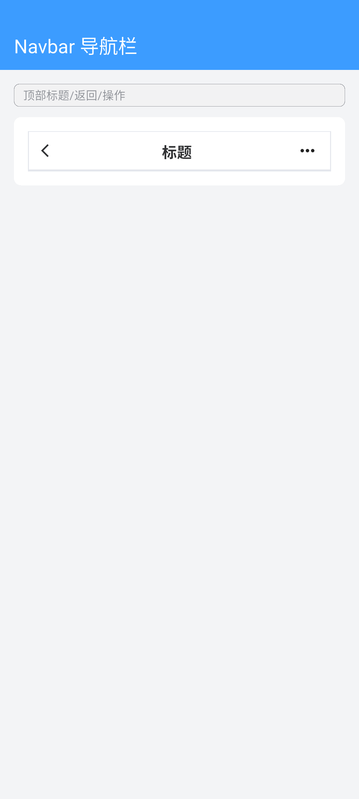

<details>
<summary>用法示例（点击展开）</summary>

```dart
class NavbarDemo extends StatelessWidget {
  const NavbarDemo({Key? key}) : super(key: key);
  @override
  Widget build(BuildContext context) => Container(
        decoration: BoxDecoration(
            border: Border.all(color: UView.of(context).borderColor)),
        child: UNavbar(
          title: '标题',
          showBack: true,
          safeAreaTop: false,
          onBack: () {},
          actions: const [
            Padding(
              padding: EdgeInsets.all(8),
              child: Icon(Icons.more_horiz),
            ),
          ],
        ),
      );
}
```

</details>

### Tabbar 标签栏

**说明**：底部切换

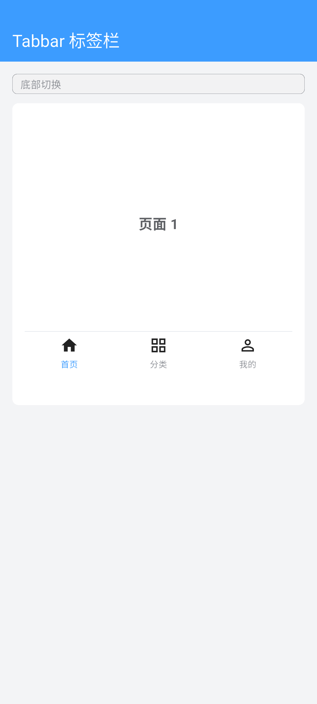

<details>
<summary>用法示例（点击展开）</summary>

```dart
class TabbarDemo extends StatefulWidget {
  const TabbarDemo({Key? key}) : super(key: key);
  @override
  _TabbarDemoState createState() => _TabbarDemoState();
}

class _TabbarDemoState extends State<TabbarDemo> {
  int _i = 0;
  @override
  Widget build(BuildContext context) => Container(
        height: 360,
        child: Column(
          children: [
            Expanded(
              child: Center(
                child: UText('页面 ${_i + 1}', size: 18, bold: true),
              ),
            ),
            UTabbar(
              currentIndex: _i,
              onTap: (v) => setState(() => _i = v),
              items: const [
                UTabbarItem(icon: Icon(Icons.home_outlined), activeIcon: Icon(Icons.home), label: '首页'),
                UTabbarItem(icon: Icon(Icons.grid_view_outlined), activeIcon: Icon(Icons.grid_view), label: '分类'),
                UTabbarItem(icon: Icon(Icons.person_outline), activeIcon: Icon(Icons.person), label: '我的'),
              ],
            ),
          ],
        ),
      );
}
```

</details>

### Tabs 标签页

**说明**：顶部标签页

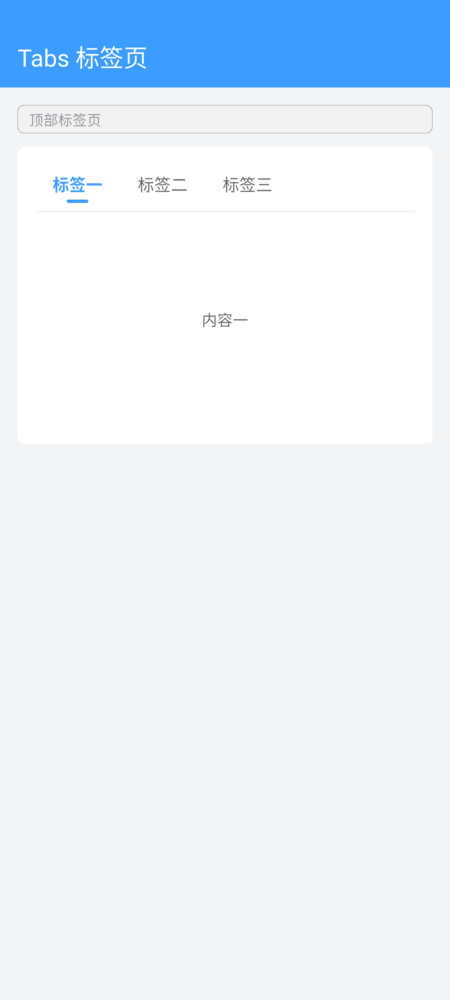

交互效果：

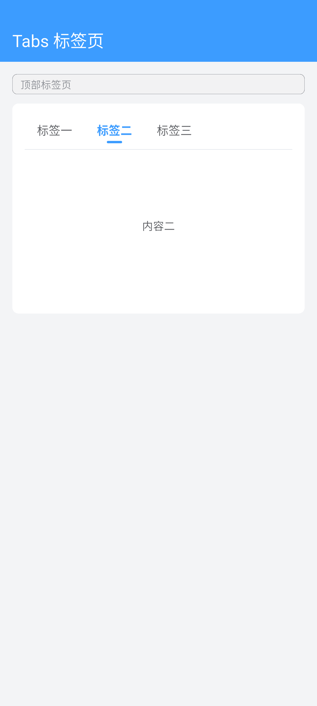

<details>
<summary>用法示例（点击展开）</summary>

```dart
class TabsDemo extends StatelessWidget {
  const TabsDemo({Key? key}) : super(key: key);
  @override
  Widget build(BuildContext context) => Container(
        height: 240,
        child: UTabs(
          tabs: const ['标签一', '标签二', '标签三'],
          children: const [
            Center(child: UText('内容一')),
            Center(child: UText('内容二')),
            Center(child: UText('内容三')),
          ],
        ),
      );
}
```

</details>

### Steps 步骤条

**说明**：横向步骤


<details>
<summary>用法示例（点击展开）</summary>

```dart
class StepsDemo extends StatelessWidget {
  const StepsDemo({Key? key}) : super(key: key);
  @override
  Widget build(BuildContext context) =>
      const USteps(steps: ['填写', '审核', '完成'], current: 1);
}
```

</details>

### Dropdown 下拉菜单

**说明**：浮层选项


交互效果：


<details>
<summary>用法示例（点击展开）</summary>

```dart
class DropdownDemo extends StatefulWidget {
  const DropdownDemo({Key? key}) : super(key: key);
  @override
  _DropdownDemoState createState() => _DropdownDemoState();
}

class _DropdownDemoState extends State<DropdownDemo> {
  int? _v;
  @override
  Widget build(BuildContext context) => Container(
        height: 240,
        child: Column(
          children: [
            UDropdown(
              options: const ['全部', '进行中', '已完成', '已取消'],
              value: _v,
              onChanged: (i) => setState(() => _v = i),
            ),
            const Expanded(
              child: Center(child: UText('下方内容可被浮层覆盖')),
            ),
          ],
        ),
      );
}
```

</details>

### BackTop 返回顶部

**说明**：滚动吸顶按钮


<details>
<summary>用法示例（点击展开）</summary>

```dart
class BackTopDemo extends StatefulWidget {
  const BackTopDemo({Key? key}) : super(key: key);
  @override
  _BackTopDemoState createState() => _BackTopDemoState();
}

class _BackTopDemoState extends State<BackTopDemo> {
  final ScrollController _c = ScrollController();
  @override
  void dispose() {
    _c.dispose();
    super.dispose();
  }
  @override
  Widget build(BuildContext context) => Container(
        height: 320,
        child: Stack(
          children: [
            Positioned.fill(
              child: ListView(
                controller: _c,
                padding: const EdgeInsets.all(12),
                children: List.generate(
                  30,
                  (i) => Container(
                    margin: const EdgeInsets.only(bottom: 8),
                    padding: const EdgeInsets.all(12),
                    decoration: BoxDecoration(
                      color: UView.of(context).surfaceColor,
                      borderRadius: BorderRadius.circular(8),
                    ),
                    child: UText('列表项 $i'),
                  ),
                ),
              ),
            ),
            Positioned(bottom: 16, right: 16, child: UBackTop(controller: _c)),
          ],
        ),
      );
}
```

</details>

## 布局组件

### Grid 宫格

**说明**：多列图标网格


<details>
<summary>用法示例（点击展开）</summary>

```dart
class GridDemo extends StatelessWidget {
  const GridDemo({Key? key}) : super(key: key);
  Widget _tile(Color c) => Container(
        width: 28,
        height: 28,
        decoration: BoxDecoration(color: c, borderRadius: BorderRadius.circular(8)),
      );
  @override
  Widget build(BuildContext context) => UGrid(
        crossAxisCount: 4,
        items: [
          UGridItem(icon: _tile(Colors.blue), label: '功能一'),
          UGridItem(icon: _tile(Colors.green), label: '功能二'),
          UGridItem(icon: _tile(Colors.orange), label: '功能三'),
          UGridItem(icon: _tile(Colors.purple), label: '功能四'),
          UGridItem(icon: _tile(Colors.teal), label: '功能五'),
          UGridItem(icon: _tile(Colors.pink), label: '功能六'),
          UGridItem(icon: _tile(Colors.indigo), label: '功能七'),
          UGridItem(icon: _tile(Colors.amber), label: '功能八'),
        ],
      );
}
```

</details>

### Swiper 轮播

**说明**：自动轮播 + 指示点


<details>
<summary>用法示例（点击展开）</summary>

```dart
class SwiperDemo extends StatelessWidget {
  const SwiperDemo({Key? key}) : super(key: key);
  @override
  Widget build(BuildContext context) => const USwiper(
        height: 140,
        autoplay: true,
        children: [
          ColoredBox(color: Colors.blue, child: Center(child: UText('幻灯片 1', color: Colors.white))),
          ColoredBox(color: Colors.green, child: Center(child: UText('幻灯片 2', color: Colors.white))),
          ColoredBox(color: Colors.orange, child: Center(child: UText('幻灯片 3', color: Colors.white))),
        ],
      );
}
```

</details>

### Avatar 头像

**说明**：圆形/方形


<details>
<summary>用法示例（点击展开）</summary>

```dart
class AvatarDemo extends StatelessWidget {
  const AvatarDemo({Key? key}) : super(key: key);
  @override
  Widget build(BuildContext context) => const URow(
        gap: 16,
        children: [
          UAvatar(child: UText('U', bold: true), size: 40),
          UAvatar(child: UText('W', bold: true), size: 56, backgroundColor: Color(0xFFE6F0FF)),
          UAvatar(shape: UViewShape.square, radius: 12, child: UText('S', bold: true), size: 48),
        ],
      );
}
```

</details>

### Empty 空状态

**说明**：空数据占位


<details>
<summary>用法示例（点击展开）</summary>

```dart
class EmptyDemo extends StatelessWidget {
  const EmptyDemo({Key? key}) : super(key: key);
  @override
  Widget build(BuildContext context) => Container(
        height: 160,
        child: UEmpty(
          text: '暂无数据',
          action: UButton(text: '刷新', onPressed: () {}),
        ),
      );
}
```

</details>

### Skeleton 骨架屏

**说明**：加载占位动画


<details>
<summary>用法示例（点击展开）</summary>

```dart
class SkeletonDemo extends StatelessWidget {
  const SkeletonDemo({Key? key}) : super(key: key);
  @override
  Widget build(BuildContext context) => const UCol(
        gap: 12,
        crossAxisAlignment: CrossAxisAlignment.start,
        children: [
          USkeleton(width: 200),
          USkeleton(width: 160, height: 12),
          USkeleton(width: 48, height: 48, shape: UViewShape.circle),
        ],
      );
}
```

</details>

### Sticky 吸顶

**说明**：滚动吸顶


<details>
<summary>用法示例（点击展开）</summary>

```dart
class StickyDemo extends StatelessWidget {
  const StickyDemo({Key? key}) : super(key: key);
  @override
  Widget build(BuildContext context) => Container(
        height: 320,
        child: USticky(
          header: Container(
            color: UView.of(context).surfaceColor,
            padding: const EdgeInsets.symmetric(horizontal: 16, vertical: 14),
            child: const UText('吸顶标题', bold: true, size: 16),
          ),
          body: List.generate(
            20,
            (i) => Container(
              padding: const EdgeInsets.all(14),
              decoration: BoxDecoration(
                border: Border(
                  bottom: BorderSide(color: UView.of(context).borderColor),
                ),
              ),
              child: UText('内容行 $i'),
            ),
          ),
        ),
      );
}
```

</details>

### Waterfall 瀑布流

**说明**：多列不等高


<details>
<summary>用法示例（点击展开）</summary>

```dart
class WaterfallDemo extends StatelessWidget {
  const WaterfallDemo({Key? key}) : super(key: key);
  static final List<double> _heights = [80, 120, 100, 140, 90, 110, 130, 70, 100, 150, 95, 120];
  @override
  Widget build(BuildContext context) => Container(
        height: 360,
        child: SingleChildScrollView(
          child: UWaterfall(
            columnCount: 2,
            spacing: 8,
            children: List.generate(_heights.length, (i) {
              return Container(
                height: _heights[i],
                decoration: BoxDecoration(
                  color: Colors.primaries[i % Colors.primaries.length].withOpacity(0.25),
                  borderRadius: BorderRadius.circular(8),
                ),
                child: Center(child: UText('卡片 $i')),
              );
            }),
          ),
        ),
      );
}
```

</details>

## 数据/其他

### Progress 进度条

**说明**：百分比/主题色


<details>
<summary>用法示例（点击展开）</summary>

```dart
class ProgressDemo extends StatelessWidget {
  const ProgressDemo({Key? key}) : super(key: key);
  @override
  Widget build(BuildContext context) => const UCol(
        gap: 12,
        crossAxisAlignment: CrossAxisAlignment.start,
        children: [
          UProgress(percent: 0.3, showText: true),
          UProgress(percent: 0.6, type: UViewType.success, showText: true),
          UProgress(percent: 0.85, type: UViewType.warning, showText: true),
          UProgress(percent: 1.0, type: UViewType.error),
        ],
      );
}
```

</details>

### CountDown 倒计时

**说明**：天时分秒


<details>
<summary>用法示例（点击展开）</summary>

```dart
class CountDownDemo extends StatelessWidget {
  const CountDownDemo({Key? key}) : super(key: key);
  @override
  Widget build(BuildContext context) => const URow(
        gap: 12,
        children: [
          UCountDown(duration: Duration(minutes: 1), textSize: 18),
          UCountDown(duration: Duration(hours: 2), textSize: 18),
        ],
      );
}
```

</details>

### CountTo 数字滚动

**说明**：动画计数


<details>
<summary>用法示例（点击展开）</summary>

```dart
class CountToDemo extends StatelessWidget {
  const CountToDemo({Key? key}) : super(key: key);
  @override
  Widget build(BuildContext context) => const URow(
        gap: 16,
        children: [
          UCountTo(end: 12345, suffix: ' 次', type: UViewType.primary),
          UCountTo(end: 99.9, decimals: 1, prefix: '¥', type: UViewType.error),
        ],
      );
}
```

</details>

### Card 卡片

**说明**：标题/内容容器


<details>
<summary>用法示例（点击展开）</summary>

```dart
class CardDemo extends StatelessWidget {
  const CardDemo({Key? key}) : super(key: key);
  @override
  Widget build(BuildContext context) => const UCard(
        title: UText('卡片标题', bold: true),
        extra: UText('更多', type: UViewType.info, size: 13),
        child: UText('这是卡片的内容区域，用于承载正文信息。'),
      );
}
```

</details>

### LoadMore 加载更多

**说明**：加载状态


<details>
<summary>用法示例（点击展开）</summary>

```dart
class LoadMoreDemo extends StatelessWidget {
  const LoadMoreDemo({Key? key}) : super(key: key);
  @override
  Widget build(BuildContext context) => const ULoadMore(status: ULoadMoreStatus.normal);
}
```

</details>

## 其他组件

### FloatingBall 悬浮球

**说明**：可拖拽 / 展开菜单


交互效果：


<details>
<summary>用法示例（点击展开）</summary>

```dart
class FloatingBallDemo extends StatelessWidget {
  const FloatingBallDemo({Key? key}) : super(key: key);
  @override
  Widget build(BuildContext context) => Container(
        height: 360,
        decoration: BoxDecoration(
          color: UView.of(context).backgroundColor,
          borderRadius: BorderRadius.circular(8),
        ),
        child: UFloatingBall(
          actions: const [
            UFloatingAction(child: Icon(Icons.edit, color: Colors.white), label: '编辑'),
            UFloatingAction(child: Icon(Icons.share, color: Colors.white), label: '分享'),
            UFloatingAction(child: Icon(Icons.add, color: Colors.white), label: '新建'),
          ],
        ),
      );
}
```

</details>
